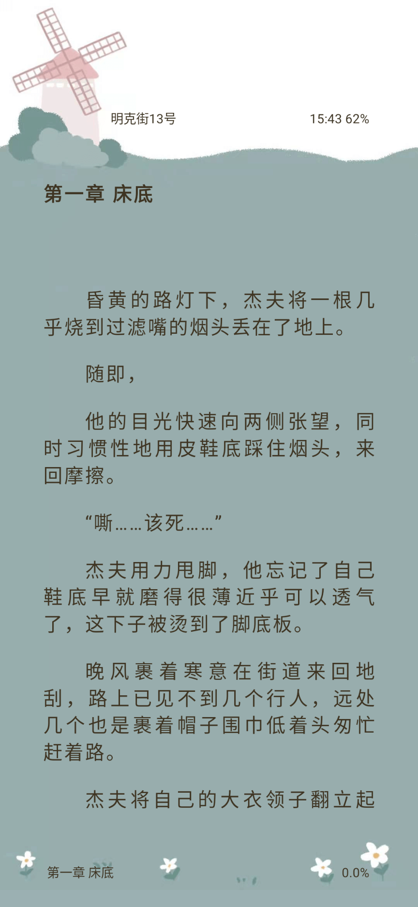
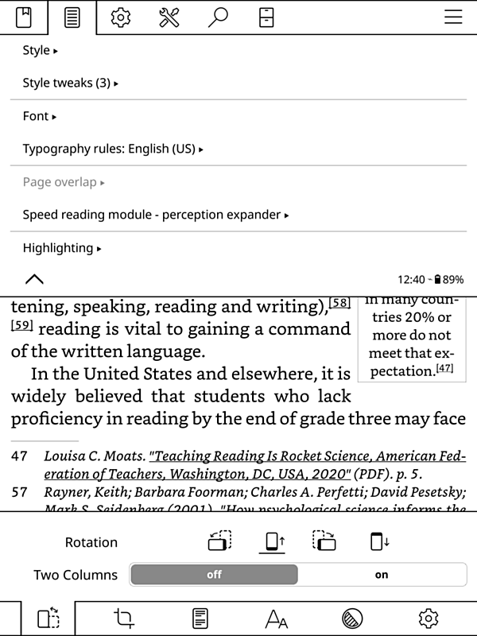
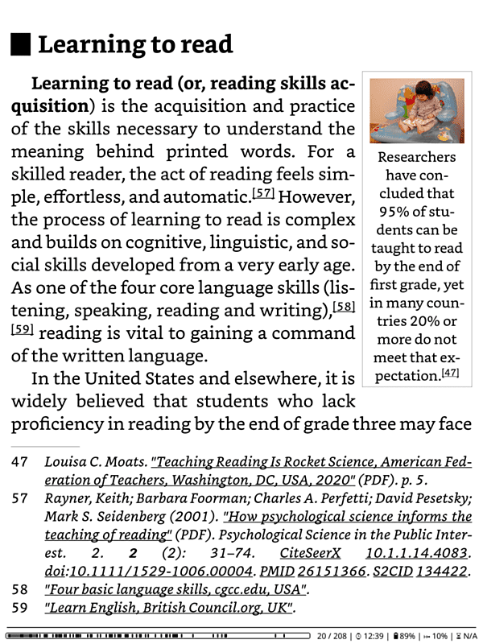
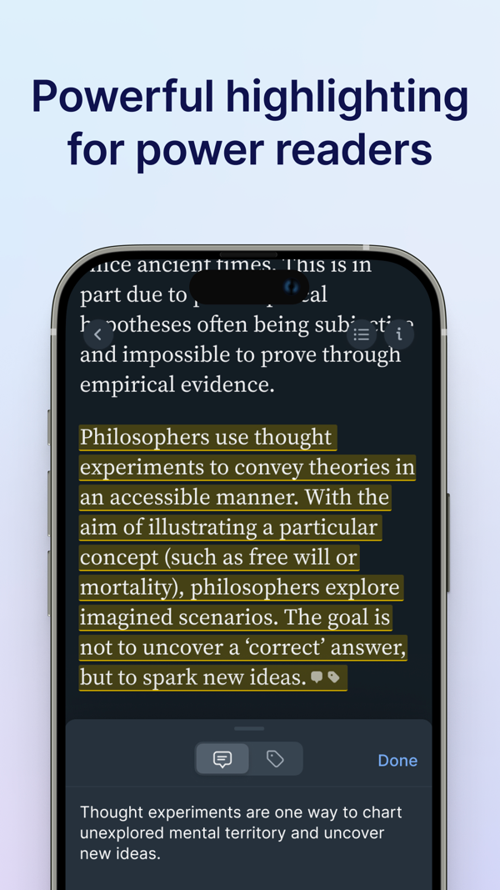
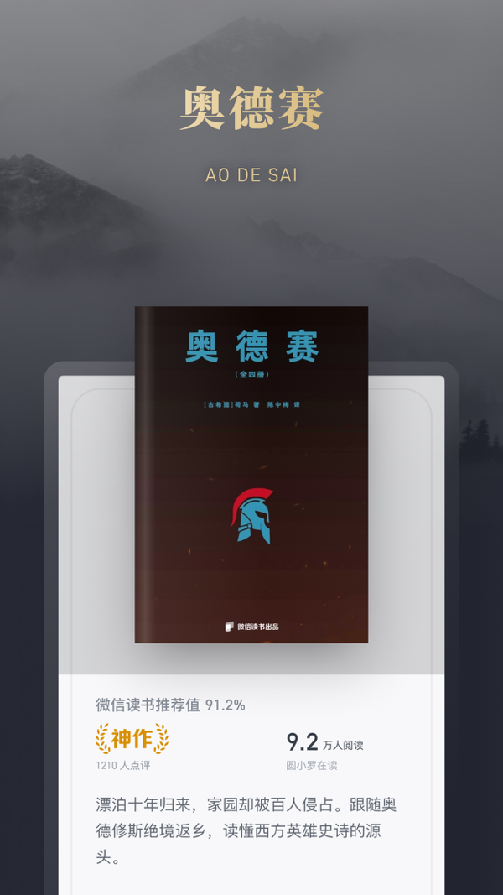

# COMPETITORS.md（Kuro Reader 竞品调研）

> 市场一句话：在移动端阅读自己拥有的长内容（漫画/电子书/网文），并把阅读痕迹沉淀为个人知识 ｜ 用途：**定差异化** ｜ 调研日期 2026-10-19，失效期 2027-01-19

## 市场界定（被中介的活动 + 为什么现在看）

**活动**：读者在 Android/Web 端阅读**自己拥有的**长内容——本地漫画压缩包（ZIP/CBZ/RAR/CBR）、电子书（EPUB/MOBI/PDF）、网文 TXT/Markdown、NAS/自建服务器（WebDAV/OPDS/FTP）上的藏书——并在阅读中积累进度、划线、批注、统计，读后把痕迹带走（导出/复习/变成知识）。

**为什么现在看（三个时机信号）**：
1. **Legado 生态崩塌**（2026-05/06 原仓库清空、侵权公告、应用商店下架，[原仓库](https://github.com/gedoor/legado) 查于 2026-10-19）——中文"自有内容阅读"用户群出现外溢窗口。
2. **Readwise Reader AI 化加速**（2026-08 Global Ghostreader 全库问答 + MCP/CLI，[官方更新信](https://readwise.io/reader/update-aug2026)）——"AI 阅读"方向头部玩家路线已明：云端订阅+无 BYOK。
3. **Kuro 五语言出海进行时**（SPEC 方向三，en/ja/ko/zh-Hant 已落地 v1.26+）——需要知道出海市场里"本地优先阅读器"生态位上谁在挡路。

## 竞品集（5 直接 + 3 间接 + 2 新兴）

| # | 竞品 | 类型 | 为什么算竞品（解决谁的什么活动） |
|---|---|---|---|
| 1 | Moon+ Reader Pro | 直接 | Android 文本阅读老牌标杆（10M+ 装机），读自有 EPUB/TXT/MOBI + TTS + WebDAV 同步，重度阅读者现有默认选项 |
| 2 | Legado（阅读·开源，含社区继承版） | 直接 | 中文开源阅读器（47.1k star），书源聚合+本地 TXT/EPUB+净化+TTS，与我们中文用户群重叠最大；虽已"死亡"但存量用户与社区继承版仍是分流对象 |
| 3 | Mihon（Tachiyomi 继承者） | 直接 | Android 漫画阅读器标杆（24.5k star），本地 CBZ/CBR 阅读+扩展源生态，漫画侧同一活动的默认选项 |
| 4 | KOReader | 直接 | 开源跨端极客阅读器（30.4k star），OPDS/自托管/calibre 生态核心客户端，"本地优先+自建服务器"同路人 |
| 5 | Readwise Reader | 直接 | AI 阅读+高亮知识沉淀方向最强对标（约 $120/年订阅），英语世界"读书变知识"用户的心智占位者 |
| 6 | 微信读书 | 间接 | 同一阅读+划线+AI 活动，但**内容平台形态**（书从平台来、AI 检索平台语料）；"最省的解"在平台侧的用户不会来找我们 |
| 7 | Komga / Kavita | 间接 | 同一活动，但**服务器侧形态**（起一个自建服务器管理书库，客户端只做阅读）；合计 ~19k star 证明自托管需求真实 |
| 8 | Obsidian 读书插件生态 | 间接 | "在笔记工具里收集读书痕迹"形态（Book Search / Apple Books Import / weread2md 等）；说明"读书痕迹最终要进笔记系统"的需求广泛存在 |
| 9 | Unearthed | 新兴 | 买断制（~$13）本地优先的 Kindle/KOReader 高亮→Obsidian 同步工具，"无订阅无云的 Readwise 替代品"——验证了我们的路线方向 |
| 10 | Chapterly | 新兴 | $22/月 AI 阅读助教（逐章讨论/测验+SRS 卡片），正面撞"知识留存"卖点但纯网页、只做文字书 |

## 逐竞品画像

### 1. Moon+ Reader / Moon+ Reader Pro（静读天下）

- 定位：全家桶式文档/电子书阅读器，定制深度公认第一 ｜ 仅 Android ｜ 免费版带广告，Pro 一次性买断（Play 标价 RRP $12.49、常见促销 $5.99 以下，曾入 Play Pass）（[Play Pro](https://play.google.com/store/apps/details?id=com.flyersoft.moonreaderp)、[官网](https://www.moondownload.com/)，查于 2026-10-19）
- 规模：免费版 10M+ 下载 / 4.5 星（269K 评价）；Pro 1M+ 下载 / 4.7 星（Play 条目，查于 2026-10-19）
- 核心功能：格式覆盖极广（txt/epub/pdf/djvu/mobi/azw3/fb2/docx/umd/chm/**cbr/cbz**/md/rar/zip + OPDS）；排版自定义之王（行距/字缩/阴影/alpha 色/10+ 主题/24 操作×15 事件/5 种自动滚动/5 种翻页动画/两端对齐+连字符）；TTS（系统引擎+摇一摇朗读+线控）；Dropbox/WebDAV 同步进度/书签/高亮/笔记；书架管理（标签/统计/桌面小部件）；46 语言
- 手记能力：多色高亮+批注+书签齐全；Pro 可分享标注；**原生导出格式不明、无 Markdown 导出**——社区靠 Python 脚本/Obsidian 插件补（[moonReader-exporter](https://github.com/unalignedcoder/moonReader-exporter)、[r/ObsidianMD](https://www.reddit.com/r/ObsidianMD/comments/1qx2faa/i_made_an_obsidian_plugin_to_sync_reading_status_and)）；**跨书高亮聚合视图 [未证实]**（官网/FAQ 均未提及）；Pro 有 Readwise 原生自动同步（[官方文档](https://docs.readwise.io/readwise/docs/importing-highlights/moon-reader)）
- AI：**未见原生 AI 功能**（官网/Play/FAQ/changelog 多源，查于 2026-10-19）
- 漫画：cbr/cbz 能读，但**无双页跨页显示**、用户抱怨体验受损（[r/ereader](https://www.reddit.com/r/ereader/comments/182sdj2/moon_reader_issue_with_comics)）；墨水屏社区读本地漫画更推荐 Mihon/PerfectViewer（[r/Onyx_Boox](https://www.reddit.com/r/Onyx_Boox/comments/1kw9iwn/reading_manga)）
- 云/本地：本地优先、无账号、Play 声明不收集数据；云通道仅 Dropbox/WebDAV（WebDAV 同步可靠性有用户投诉，[MobileRead 2026-03](https://www.mobileread.com/forums/forumdisplay.php?f=178) 检索综述）
- 优势：定制深度与格式广度第一；买断制性价比口碑；Readwise 工作流打通 ｜ 劣势：学习曲线陡（休闲读者劝退）；重度批注场景稳定性投诉；漫画体验差
- 近期动向：免费版 v10.7（2026-07-21，漫画信息导入优化+PDF 批注修复）；Pro v10.1（2026-10-13）；官网为俄/白俄用户发临时 APK（支付通道区域受阻迹象）
- 截图：[截图未取得]（Google Play 本机被墙、官网首页无界面截图页；下次刷新可走酷安实拍）

### 2. Legado（阅读·开源，gedoor/legado → 社区继承）

- 定位：自定义书源的网络内容聚合阅读器，本地书是附属能力 ｜ 仅 Android ｜ 完全免费开源 GPL-3.0、无广告（[官网](https://gedoor.github.io)，查于 2026-10-19）
- 规模：原仓库 47.1k star / 5.6k fork；酷安已下架（条目 404），历史装机量硬数据 [未证实]（社区口径数百万级）
- **重大事实：原版已终结**——2026-03 传作者涉刑责（无权威通报）；2026-05-27 原仓库最后更新后**清空代码与 Releases，仅剩侵权公告**；应用商店全面下架（[原仓库现状](https://github.com/gedoor/legado)、[TG 频道](https://t.me/s/Legado_Channels/1337)、[什么值得买 2026-08-23](https://post.smzdm.com/p/ak8x5drr)，查于 2026-10-19）
- 社区继承：LegadoTeam 组织 2026-07-13 起重新发版至 08-22 共 39 版（约一天一版），但无正式 Releases、APK 走 TG/第三方站；另有"阅读 Sigma/NG/Archive"等分支碎片化且**备份互不兼容**（同上来源）
- 核心功能：JS 书源引擎（Rhino，任何网页变书源）；本地 **仅 TXT/EPUB**（官方帮助文档明写）；RSS 订阅；替换净化（正则规则+JSON 导入导出+社区规则库，规则多会拖慢搜索——官方 CHANGELOG 自认）；TTS（系统+第三方引擎+httpTTS 在线朗读体系）；WebDAV 每日自动云备份（书架/进度/书源/替换/设置）；**无 OPDS [未证实]**（文档未提及）
- 手记能力：长按选中→标注/想法，**官方帮助文档通篇不覆盖笔记功能**（成熟度可见）；跨书聚合 [未证实]；分支专门补"一键导出 Obsidian"恰好反证原版短板（[Jingshiro/legado](https://github.com/Jingshiro/legado)）
- AI：原版零 AI；社区靠书源 JS 调 LLM API 变通、"阅读 NG"分支实验性 AI 辅助（[legado_NG](https://github.com/joestar817/legado_NG)）——无官方、无产品化
- 漫画：仅"在线图片书源+滚动渲染"；**本地 CBZ/CBR 不支持**（官方文档，查于 2026-10-19）
- 优势：书源生态与免费社区无可匹敌；WebDAV 备份开箱即用 ｜ 劣势：法律风险已现实爆发（下架+仓库清空）；上手门槛极高；官方渠道断裂+分支碎片化
- 近期动向：社区版高频 beta 流；治理合法性与信任链（第三方站分发）双弱
- 截图：[官方界面截图·官网取]（原官网仍在线）
  - 
  - 
  - 来源 https://gedoor.github.io （查于 2026-10-19；官网资产，原版界面）

### 3. Mihon（mihonapp/mihon）

- 定位：插件源驱动的漫画/网漫聚合阅读器，Tachiyomi 社区继承者 ｜ Android 8.0+ ｜ 免费开源 Apache-2.0（[GitHub](https://github.com/mihonapp/mihon)，查于 2026-10-19）
- 规模：24.5k star；v0.21.2 单版本 arm64 APK 下载 ≈29.5 万（GitHub API，查于 2026-10-19）
- 核心功能：本地源（图片文件夹/ZIP/CBZ/RAR/CBR/EPUB 按图片压缩包解析，**EPUB 不按章切分**）；多查看器/多阅读方向可配置阅读器；分类书库+定时更新；**追踪器 8 家**（MAL/AniList/Kitsu/MangaUpdates/Shikimori/Bangumi/Hikka/MangaBaka，v0.21.0 新增 Comick）；本地/云备份；社区扩展源生态
- 手记能力：仅 per-title 备忘笔记（作品详情页内），**无页内划线/文字批注、无全库笔记视图**——全局视图是长期未实现的开放 FR #3286（[issue](https://github.com/mihonapp/mihon/issues/3286)，查于 2026-10-19）
- AI：官方核心**未见 AI 功能**（repo/docs/releases，查于 2026-10-19）
- 文本格式：**零文本排版能力**（TXT/MD/PDF/MOBI 均不支持，[本地源文档](https://mihon.app/docs/guides/local-source/)）——漫画用户读书必须双 app
- 云/本地：全本地无账号；"云"仅指备份自存云盘；内容获取依赖第三方扩展源（Cloudflare 反爬致源频繁失效是常态抱怨，r/mangapiracy 多帖）
- 优势：扩展源+追踪器生态同类最全；维护极活跃（2026-10 月内三连发 v0.21.0→0.21.2）；免费开源+大库性能优化 ｜ 劣势：源扩展频繁失效；v0.21 迁移摩擦（弃用旧备份格式）；纯漫画
- 近期动向：v0.21.2（2026-10-13，.tachibk 收尾版）；v0.21.0（10-11，性能+Comick）
- 截图：[宣传图·官网首页手机框渲染]
  - 
  - 来源 https://mihon.app （查于 2026-10-19；含手机壳渲染，非裸截图，透明底 webp）

### 4. KOReader

- 定位：面向墨水屏设备（Kindle/Kobo/PocketBook/reMarkable/Android/Linux）的全格式开源阅读器，自托管/侧载生态核心客户端 ｜ 免费 AGPL-3.0（[GitHub](https://github.com/koreader/koreader)，查于 2026-10-19）
- 规模：30.4k star；最新稳定版 v2026.07.1（2026-08-01），季度节奏+每日 nightly，维护健康
- 核心功能：格式广（PDF/DjVu/CBT/CBZ/EPUB/FB2/Mobi/DOC/RTF/HTML/CHM/TXT；**无 Markdown、无 RAR/CBR**）；crengine 重排+K2pdfopt 扫描重排；深度 calibre 集成（元数据/无线传书/OPDS）；**OPDS 2.0**（v2026.07 新）；划线 4 样式+笔记（sidecar 存储）；高亮导出插件（Text/HTML/**Markdown**/JSON/Joplin/Readwise/Memos/Flomo/XMNote）；StarDict 词典+Wikipedia 取词；FTP/SSH/WebDAV（v2026.07 新 Cloud storage 插件）；KOReader Sync 进度同步
- 硬缺口：**日文竖排（縦書き）不支持**——开放 FR #11469，社区靠个人 fork tategumi 补 vertical-rl（[issue #11469](https://github.com/koreader/koreader/issues/11469)、[tategumi fork](https://github.com/m-tky/koreader-tategumi)，查于 2026-10-19）；**无内置 TTS**（issue #14906，需第三方 audiobook.koplugin/云服务）；PDF 高亮不可调整范围须删除重标
- AI：官方核心无；插件生态有成熟 AI 助手（[assistant.koplugin](https://github.com/omer-faruq/assistant.koplugin)：阅读中问 AI，支持 OpenAI/Claude/Gemini/DeepSeek/Ollama——**事实上的 BYOK**，但需手动装插件、墨水屏交互门槛高）
- 优势：墨水屏覆盖与性能（旧设备翻页延迟减半）；排版/词典/翻译深度业界最全；批注导出生态开箱 ｜ 劣势：无竖排、无内置 TTS；批注互通靠脚本/桌面工具；极客向 UI
- 近期动向：v2026.07 "Sailing Walrus"（Cloud storage/WebDAV 重构、OPDS 2.0）→ v2026.07.1（2026-08-01）
- 截图：[官方界面截图·官方 artwork 仓库取]
  - 
  - 
  - 来源 https://github.com/koreader/koreader-artwork （查于 2026-10-19）

### 5. Readwise Reader

- 定位：为重度读者造的 read-later + 高亮 + AI 阅读平台 ｜ Web/iOS/Android ｜ **订阅制无免费档**（30 天试用；Lite $5.59/月不含 Reader app；Full $9.99/月年付约 $120/年）（[定价页](https://readwise.io/pricing)、[订阅 FAQ](https://docs.readwise.io/faqs/subscription)，查于 2026-10-19）
- AI（Ghostreader）：单文档总结/对话问答/词条查询/任意语言互译/自定义 prompt+社区库；**Global Ghostreader（2026-08）**：全库逐词索引跨库问答带引用+agent 四技能（分拣收件箱/自动打标签/主题研究/文摘），**仅 web/桌面端**；另发布 MCP/CLI 供外部 agent 检索管理其库（[官方更新信](https://readwise.io/reader/update-aug2026)，查于 2026-10-19）
- **无 BYOK**：AI 绑定自家 Ghostreader，推理成本官方承担（用户无法换用自己的 key/模型）（多源，查于 2026-10-19）
- EPUB/PDF：可上传，2025-06 "EPUBs v2" 引擎重写后改善，但社区仍反馈不如专业阅读器顺手（[r/readwise](https://www.reddit.com/r/readwise/comments/1dyvie7/what_do_you_guys_think_about_the_book_reading)）；重心是网页/Newsletter read-later；**无漫画支持**
- 高亮管理：Daily Review 间隔重复（App+邮件）；官方 Obsidian 插件/Notion 原生集成持续同步
- Android 端：原生 app 存在（com.readermobile），2026-08 随 Readwise 2.0 整体重写（拍照扫描纸质划线/语音采集）；美区 App Store 4.61 分仅 585 评分（iTunes API，查于 2026-10-19）；社区有更新放缓担忧（8 个月一期更新信）
- 优势：多源高亮聚合+复习+官方导出生态成熟度第一；AI 深度（全库引用式问答+MCP）业内第一梯队 ｜ 劣势：$120/年账号云制（与本地优先哲学相反）；read-later 优先、EPUB 二等公民、漫画缺失；AI 无 BYOK；移动端 Global Ghostreader 缺位
- 近期动向：2026-08-06 Update #14（Global Ghostreader+移动端重写+MCP/CLI）；路线图含更好 TTS 音色、移动端 Global Ghostreader
- 截图：[官方截图·App Store iTunes API 取]
  - 
  - 
  - 来源 iTunes API（trackId 1567599761，查于 2026-10-19）

### 间接：微信读书 ｜ Komga/Kavita ｜ Obsidian 插件生态

- **微信读书**：书城生态形态——AI 问书（2024-05 混元 RAG，2025-04 接 DeepSeek）、AI 大纲（30 秒全书框架）全部基于**平台语料**；会员约 19 元/月（2021 价，[部分证实]）；**官方无批量 Markdown 导出**（网页版单书导出+第三方插件生态繁荣：微信读书助手/weread2md/Writeathon——恰好证明导出需求被压抑）；App Store 4.86 分 170 万评分（iTunes API，查于 2026-10-19）。商业模式=卖内容访问权，用户自有文件非一等公民——与 Kuro 工具形态（用户自备内容+自有 key AI）只在"划线笔记+AI 辅读"心智上重叠。
  - （[官方截图·App Store]，查于 2026-10-19）
- **Komga**（6.8k star，MIT，2026-10 仍活跃）：自建漫画/电子书媒体服务器，OPDS/API/Kobo Sync/KOReader Sync/Mihon 扩展；**Kavita**（11.9k star，2026-10-18 仍活跃）："一站式阅读服务器"漫画+电子书通吃（[Komga](https://komga.org/)、[Kavita](https://kavitareader.com/)，查于 2026-10-19）。服务器侧形态：用户用「Komga+Mihon/KOReader」组合可替代「本地文件+WebDAV/OPDS 导入」的客户端一体化方案——但要求用户会起服务器。Kuro 的 OPDS 客户端能力（连 Calibre/Komga/Kavita）同时把它们变成互补生态。
- **Obsidian 读书插件生态**：Book Search/Apple Books Import/weread2md/微信读书助手等——"读书痕迹最终要进笔记系统"的需求广泛存在的旁证；Kuro 的原生 MD 导出+Obsidian 兼容 #标签 正是对这条需求链的端内答案。

### 新兴：Unearthed ｜ Chapterly（+Glasp 一句话）

- **Unearthed**（unearthed.app）：隐私优先的 Kindle/KOReader 高亮→Obsidian 同步，桌面 Local 版**买断约 $13、无订阅无云**（[官网](https://unearthed.app/local)，查于 2026-10-19）——"买断+本地优先的 Readwise 替代品"需求已被验证，但它只是同步配件不是阅读器。
- **Chapterly**（chapterly.ai）："严肃读者的 AI 助教"，逐章讨论/测验+高亮自动转 SRS 卡片，$22/月 [部分证实]（官网 JS 渲染未核验，[r/SideProject 创始人帖](https://www.reddit.com/r/SideProject/comments/1s2cpxh/)，查于 2026-10-19）——纯网页、只做文字书、无漫画/摘抄墙/本地数据。
- **Glasp**：社交化网页/PDF 高亮器，免费档 AI 摘要 3 次/天，Pro $10/月（[定价](https://glasp.co/pricing)，查于 2026-10-19）——只在网页高亮边缘重叠。

## 截图墙（直接竞品并排，界面范式一眼见差异）

| 竞品 | 截图 1 | 截图 2 | 来源标注 |
|---|---|---|---|
| Legado |  |  | [官方界面截图·官网] |
| Mihon |  | — | [宣传图·官网手机框渲染] |
| KOReader |  |  | [官方界面截图·artwork 仓库] |
| Readwise |  |  | [官方截图·iTunes API] |
| 微信读书(间接) |  |  | [官方截图·iTunes API] |
| Moon+ | [截图未取得]（Play 被墙+官网无界面截图；刷新时走酷安实拍） | — | — |

范式观察（[解读]）：Legado/微信读书是"书架中心"信息密度型范式；Mihon 是"封面网格"漫画库范式；KOReader 是墨水屏极简功能菜单范式；Readwise 是"高亮卡片流"知识范式。Kuro 的"图书馆隐喻（门厅/座位/回望席）"在截图墙中无同类——视觉心智独占，但也意味着无现成范式可蹭，上手教育成本要自己扛。

## 对比矩阵

行 = table staples + 差异项。Kuro 列为**现状**（README/SPEC，2026-10）；空白=该竞品无此能力且已核实；[未证实]=未查到可靠信息。

| 能力 | Kuro（现状） | Moon+ Pro | Legado | Mihon | KOReader | Readwise | 微信读书 |
|---|---|---|---|---|---|---|---|
| 平台 | Android+Web | Android | Android | Android | Android/iOS越狱/墨水屏/Linux | Web/iOS/Android | 全平台 |
| 定价 | 免费无广告 | 买断 $5.99-12.49 | 免费开源 | 免费开源 | 免费开源 | 订阅 ~$120/年 | 订阅 19元/月+内容付费 |
| 文本格式 | TXT/MD/EPUB/PDF/MOBI/AZW3 | 全家桶（含 md） | **仅 TXT/EPUB** | **零文本** | 广（无 MD/CBR） | EPUB/PDF/网页 | 平台书+受限导入 |
| 漫画格式 | ZIP/CBZ/RAR/CBR+条漫/页漫双模式 | 能读但无双页跨页 | 本地不支持 | **一等公民** | CBZ/CBT（无 CBR） | 无 | 无 |
| 竖排 vertical-rl | ✅ | [未证实] | [未证实] | 漫画方向可配 | **不支持**（民间 fork） | 无 | 平台书部分支持 |
| TTS | 系统/神经/自建三路 | 系统引擎 | 系统+第三方+httpTTS | 无 | **无内置**（插件） | 有（官方云） | 有（AI 主播） |
| 划线/批注 | 划线批注分离+3 笔触+稳定锚点 | 多色高亮+批注 | 基础（文档不覆盖） | **无划线**（仅 per-title 备忘） | 4 样式+笔记 | 高亮+笔记 | 高亮+想法 |
| 跨书笔记聚合 | **摘抄墙**（检索/筛选/标签/回望席） | [未证实] | [未证实] | 无（FR #3286 未实现） | 无（靠导出后外部聚合） | 有（高亮库+复习） | 有（笔记 tab） |
| Markdown 导出 | ✅ 单书/整墙，Obsidian/Notion 兼容 | 无原生（社区脚本） | TXT/MD/HTML [单源待证] | 无 | ✅ 插件（MD/JSON/Joplin 等） | ✅ 官方同步 | 官方无（第三方插件） |
| AI 能力 | **LLM 知识库 8 类知识件，BYOK** | 无 | 无（社区脚本变通） | 无 | 插件可 BYOK（assistant.koplugin） | Ghostreader（全库问答+agent，**无 BYOK**） | AI 问书/大纲（平台语料） |
| 间隔重复复习 | 回望席（周年/当日确定性回访） | 无 | 无 | 无 | 无 | **Daily Review**（SRS） | 无 |
| 原文净化 | TXT 广告/排版 A/B 类+按书门槛 | 无 | **替换净化**（正则+社区规则库） | 无 | 无 | 无 | 无 |
| 云端获取 | WebDAV(含 rclone)/OPDS/FTP+多端同步 | Dropbox/WebDAV 同步+OPDS | WebDAV 备份+书源抓取 | 扩展源（在线盗版源生态） | OPDS 2.0/WebDAV/calibre/FTP | 自家云（账号制） | 平台书城 |
| 本地优先/无账号 | ✅ | ✅ | ✅ | ✅ | ✅ | ❌（云账号） | ❌（云账号） |
| 追踪器（MAL/AniList 等） | 无 | 无 | 无 | **8 家** | 无 | 无 | 无 |
| 词典/取词 | 无 | [未证实] | [未证实] | 无 | **StarDict+Wiki** | 词条查询（AI） | 长按查词 |
| UI 多语言 | 5 语（zh/zh-Hant/en/ja/ko） | 46 语 | 中文为主 | 英文+社区翻译 | 多语言 | 英文为主 | 中文 |
| 桌面小组件 | ✅（2 枚） | ✅ 书架小部件 | [未证实] | 无 | 无 | 无 | 无 |
| 应用锁 | ✅ 手势密码 | 无 | 无 | 无 | 无 | 无 | 无 |

## 定位图（文字版 2x2）

- **横轴：数据主权**——左=云端账号制（数据在厂商）；右=本地优先无账号（数据在用户手里）。选择理由：这是 Kuro 产品哲学的根，也是与 Readwise/微信读书的商业模式分界线。
- **纵轴：知识纵深**——下=纯阅读工具（读完即走）；上=知识沉淀系统（划线→聚合→复习→AI 加工）。选择理由：这是 Kuro 差异化的主战场（摘抄墙+LLM 知识件）。

```
知识纵深高
    ↑
    │  Readwise Reader        【空白象限】
    │  Chapterly              ★ Kuro Reader
    │  微信读书(半格:AI在云)
    │─────────────────────────────────────→ 数据主权弱(云端)
    │  ┌──────────────────────┬──────────────────────┐
    │  │ 左上：云端知识派      │ 右上：本地知识派(仅Kuro)│
    │  │ Readwise/Chapterly   │ ★ Kuro                │
    │  │ 微信读书             │ Unearthed(配件,不阅读) │
    │  ├──────────────────────┼──────────────────────┤
    │  │ 左下：—              │ 右下：本地工具派        │
    │  │                      │ Moon+/Legado/Mihon    │
    │  │                      │ KOReader/ReadEra      │
    │  │                      │ Komga/Kavita(服务器侧) │
    │  └──────────────────────┴──────────────────────┘
    └─────────────────────────────────────→ 数据主权强(本地)
                                              知识纵深低
```

各家落点理由：Readwise/Chapterly/微信读书 = 知识/AI 强但数据在云；Moon+/Legado/Mihon/KOReader = 本地优先但笔记/AI 弱（KOReader 导出链最强但无 AI 无聚合复习）；**右上象限（本地优先×深知识）只有 Kuro 一家**——Unearthed 在该象限但只是同步配件不覆盖阅读本体。

## 差异化机会（对应矩阵/定位图发现）

1. **[事实]** 5 家直接竞品无一同时具备"本地优先无账号 + 原生 AI + 知识件生成"；KOReader 的 BYOK AI 是第三方插件且墨水屏交互受限。**[解读]** Kuro 的"本地优先 × LLM 知识库（BYOK）"是无人占位的组合，且 Readwise 的无 BYOK/$120 年费制造了明确的出逃用户群（隐私/成本敏感者）。
2. **[事实]** Legado 生态因侵权崩塌（仓库清空+商店下架），其"本地 TXT/EPUB+净化+TTS+WebDAV"能力无人完整承接；官方本地格式仅 TXT/EPUB、无本地漫画。**[解读]** 中文市场存在"想好好读自有内容、不想碰书源灰产"的用户外溢，Kuro 的净化+WebDAV+本地漫画组合是现成接收位，且有合法性叙事（工具不碰内容分发）。
3. **[事实]** 笔记导出是全行业软肋：Moon+ 无原生 Markdown、ReadEra 仅 txt、Mihon 无划线、Legado 文档不覆盖；微信读书官方不提供批量导出（第三方插件繁荣=需求压抑的证据）。**[解读]** 摘抄墙+原生 Markdown 导出（Obsidian/Notion 兼容）是稀缺品，值得作为营销主打之一。
4. **[事实]** 漫画/文本统一无人做：Mihon 零文本排版，Moon+ 漫画无双页跨页，KOReader 无 CBR/竖排，Readwise 无漫画。**[解读]** "一个 app 读完全部自有内容"是可守的差异位，继续投漫画阅读质量（双页/条漫/章节识别三层判定）。
5. **[事实]** KOReader 日文竖排靠民间 fork、无内置 TTS。**[解读]** 出海日本市场（SPEC 场景 Haruto 读日文漫画）时，竖排+TTS 组合是 KOReader 用户的迁移理由。
6. **[事实]** Readwise Daily Review（SRS 复习）是其粘性核心；Kuro 的回望席是确定性/周年回访，无间隔重复。**[解读]** 这是被验证有效的留存机制，Kuro 有基础形态可演进（反向学习项）。
7. **[事实]** Mihon 的追踪器集成（MAL/AniList 等 8 家）是漫画社区 table stakes。**[解读]** 出海日本/英语市场的漫画用户预期"读完同步 MAL"，缺失会成为劝退点（反向学习项）。

## 三档建议

### 加倍（别人没做/没做好的，我们加倍投入）

1. **LLM 知识库 + BYOK**：全行业唯一的"本地优先+原生 AI+知识件"组合，且竞品 AI 要么没有（Moon+/Legado/Mihon）、要么云订阅无 BYOK（Readwise/微信读书）。继续深化 8 类知识件质量与多语言产物（M-i18n.4 正在做的事），把"无订阅费、用你自己的 key"做成显性营销点。
2. **摘抄墙/跨书聚合 + Markdown 导出**：全行业软肋位（微信读书第三方插件生态证明需求被压抑）。摘抄墙+回望席+一键 MD 带走 = "读完还是手记采集器官"的完整故事。
3. **Legado 用户接收（中文市场窗口期）**：出"Legado 用户迁移指南"（TXT/EPUB 本地导入+净化规则对照+WebDAV 备份迁移），主打合法性叙事（Kuro 不碰内容分发，永远不会有下架日）。窗口有时效性——LegadoTeam 若稳定下来窗口会收窄。
4. **漫画+文本统一阅读质量**：无人竞争的差异位；漫画侧对齐 Mihon 的阅读体验（双页/方向/预载），文本侧对齐 Moon+ 的排版自定义深度。

### 补差距（table stakes 缺口，补到及格，不超车）

1. **排版自定义深度**：Moon+ 是标杆（行距/边距/翻页动画/自动滚动）。补基础项到"重度读者不劝退"即可，不必卷 24 操作×15 事件的全自由度。
2. **追踪器同步（MAL/AniList/Kitsu）**：出海日本/英语漫画社区的预期配置；做基本的"读完标一章"级同步即可。
3. **高亮间隔重复复习**：Readwise 验证过的留存机制；在回望席上加轻量 SRS（不必做 Anki）。
4. **词典/取词**：KOReader 的 StarDict 取词是深度阅读刚需；接入系统词典或在线词典的选词查询即可。

### 忽略（看似差距实非差距，显式写明为什么）

1. **在线书源/内容聚合**（Legado/Mihon 的核心）：法律风险已被 Legado 之死证明；Kuro 坚决不碰内容分发**正是**差异化的一部分（合法工具形态）。这是战略选择不是能力缺口。
2. **扩展/插件生态**（KOReader/Mihon 的插件体系）：重维护负担，且 Kuro 的功能内聚路线（8 类知识件内置）不需要社区插件长尾；BYOK 的 AI 需求已由内置 LLM 知识库覆盖。
3. **社交阅读/想法广场**（微信读书）：与本地优先/隐私哲学相反，形态不同不必跟。
4. **墨水屏设备深度适配**（KOReader 的 Kindle/Kobo 越狱生态）：不同用户群、越狱侧载渠道本身在萎缩；Android/Web 双端是正确边界。
5. **网页 read-later**（Readwise 的主阵地）：内容源是网页/Newsletter，与"自有漫画/电子书图书馆"定位不同心；不追。

## 证据与日期戳

主要来源（全部查于 2026-10-19）：

- Moon+：[官网](https://www.moondownload.com/)、[FAQ](https://www.moondownload.com/faq.html)、[Play 免费](https://play.google.com/store/apps/details?id=com.flyersoft.moonreader)/[Pro 条目](https://play.google.com/store/apps/details?id=com.flyersoft.moonreaderp)、[Readwise 导入文档](https://docs.readwise.io/readwise/docs/importing-highlights/moon-reader)、[r/ereader 漫画帖](https://www.reddit.com/r/ereader/comments/182sdj2/moon_reader_issue_with_comics)、[moonReader-exporter](https://github.com/unalignedcoder/moonReader-exporter)
- ReadEra：[官网](https://readera.org/)、[Premium 页](https://readera.org/premium)、[r/ReadEra](https://www.reddit.com/r/ReadEra/comments/1ouf0x7/text_to_speech)
- Legado：[原仓库现状](https://github.com/gedoor/legado)、[社区继承仓库](https://github.com/LegadoTeam/legado)、[官网](https://gedoor.github.io)、[什么值得买事件梳理 2026-08-23](https://post.smzdm.com/p/ak8x5drr)、[TG 频道](https://t.me/s/Legado_Channels)、[Jingshiro 分支](https://github.com/Jingshiro/legado)
- Mihon：[GitHub](https://github.com/mihonapp/mihon)、[本地源指南](https://mihon.app/docs/guides/local-source/)、[releases](https://github.com/mihonapp/mihon/releases)、[FR #3286](https://github.com/mihonapp/mihon/issues/3286)
- KOReader：[GitHub](https://github.com/koreader/koreader)、[user guide](http://koreader.rocks/user_guide/)、[竖排 issue #11469](https://github.com/koreader/koreader/issues/11469)、[TTS issue #14906](https://github.com/koreader/koreader/issues/14906)、[assistant.koplugin](https://github.com/omer-faruq/assistant.koplugin)
- Readwise：[定价](https://readwise.io/pricing)、[订阅 FAQ](https://docs.readwise.io/faqs/subscription)、[Ghostreader](https://docs.readwise.io/reader/guides/ghostreader/overview)、[2026-08 更新信](https://readwise.io/reader/update-aug2026)、[EPUB 引擎更新](https://readwise.io/reader/update-june2025)、[Obsidian 导出](https://docs.readwise.io/readwise/docs/exporting-highlights/obsidian)
- 微信读书：[AI 问书词条](https://baike.baidu.com/item/AI%E9%97%AE%E4%B9%A6/67653967)、[腾讯云 RAG](https://cloud.tencent.com/developer/article/2433150)、[应用宝 AI 功能](https://sj.qq.com/blog/1743567509000)、[微信读书助手插件](https://chromewebstore.google.com/detail/kbnkpllgdjcalefobaphghpiiingeljj)
- Komga/Kavita：[komga.org](https://komga.org/)、[kavitareader.com](https://kavitareader.com/)（GitHub API star 数）
- 新兴：[unearthed.app/local](https://unearthed.app/local)、[chapterly.ai](https://chapterly.ai)、[glasp.co/pricing](https://glasp.co/pricing)

[未证实] 清单：Moon+ 高亮具体色数与形状样式；Moon+ 跨书高亮聚合视图；Moon+/Legado FTP 支持；Legado 笔记导出格式（单源 AIGC 教程）；Legado 历史装机量硬数据；Mihon 第三方 AI 扩展传闻；KOReader 下载量级；微信读书 2026 年国内现价（19 元/月为 2021 数据）；Chapterly 官网定价页（JS 渲染未核验）。

截图来源标注：[官方截图·iTunes API]（微信读书/Readwise）、[官方界面截图·官网/artwork 仓库]（Legado/KOReader）、[宣传图·官网手机框渲染]（Mihon，非裸截图）；Moon+ 未取得（Play 被墙+官网无界面截图）。技术注记：本机 curl 需 `--ssl-no-revoke`；iTunes 高清变体 URL 尾参 `600x0w.png`。

## 变更日志

- 2026-10-19 初版（用途：定差异化）。4 路联网实调（官网/Play/GitHub/Reddit/知乎/什么值得买）+ 9 张截图取证（front-viewer 核验全 PASS）。重大发现：Legado 原版已终结（2026-05/06）；KOReader 无竖排/无内置 TTS；Readwise 无 BYOK。失效期 2027-01-19。
